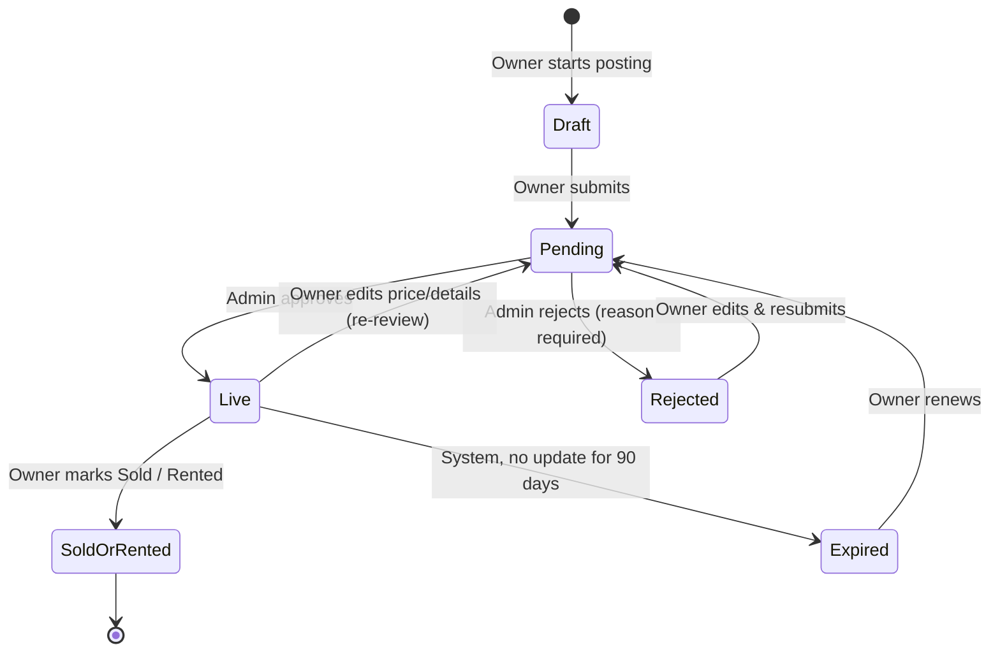
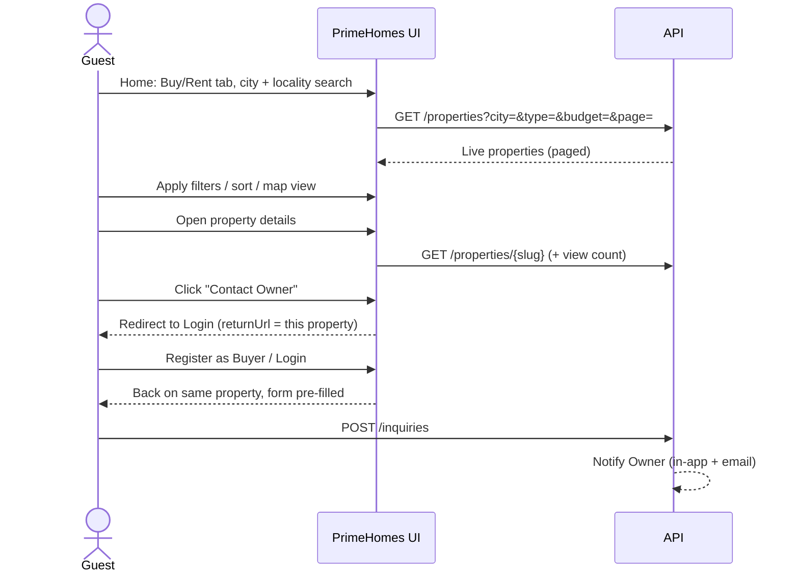
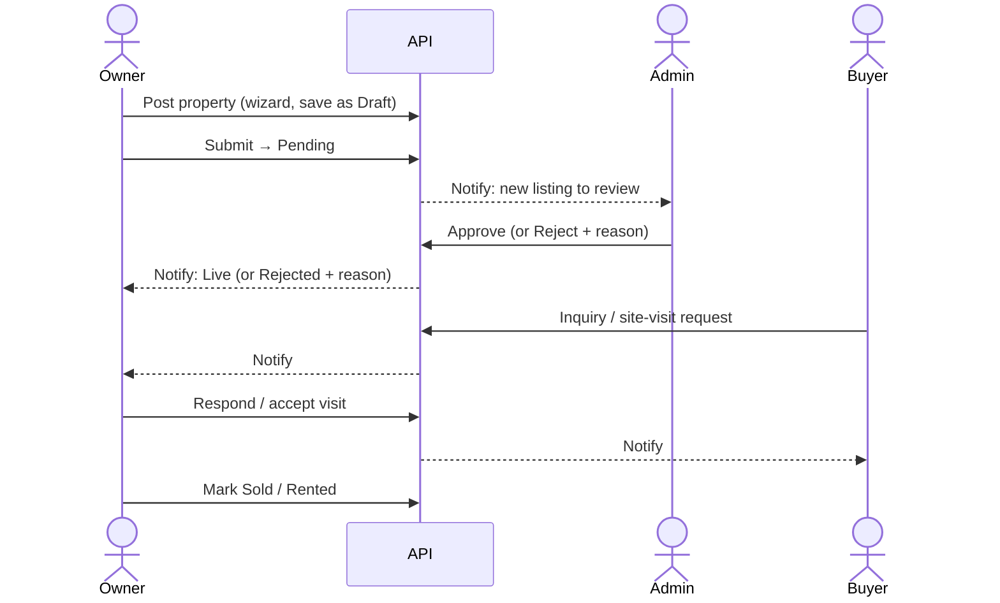

# PrimeHomes — Industry-Level Upgrade Plan

> Reference: **99acres** (flows and page structure only — PrimeHomes keeps its own brand, logo, colours and copy).
> Stack: Angular 22 · ASP.NET Core 8 Web API · EF Core · SQL Server.
> Legend — **Size:** S = small, M = medium, L = large · **Tier:** Core = required, T1 = recommended enhancement, T2 = differentiator, T3 = production ops.

---

## 1. Current state (gap summary)

| Area | Today | Gap |
|---|---|---|
| Security | Anyone can register as Admin; plain-text passwords; anonymous file upload; JWT key committed | Critical |
| Database | Fresh DB cannot be built from migrations alone (needs part of `SQLQuery3.sql`) | High |
| Flow | Login required just to browse; no session-expiry handling; `alert()` popups; notification count not refreshed after login | High |
| UI | Decent, but emoji icons, 800+ line components, 1.08 MB initial bundle (budget 500 kB) | Medium |
| Quality | No backend tests; frontend tests fixed (30/30 passing) | Medium |

---

## 2. Roles and responsibilities

| Role | Who | Responsibilities | Cannot |
|---|---|---|---|
| **Guest** | Anyone, not logged in | Browse, search, filter, view property details, use EMI calculator, view map & nearby places, submit general contact request | Shortlist, contact owner, review, schedule visit |
| **Buyer** | Registered as Buyer | Everything a Guest can + shortlist, compare, contact owner, schedule site visit, review properties, save searches & get alerts, manage profile, view My Activity | Post properties, access admin |
| **Owner** | Registered as Owner | Post / edit / delete own properties, upload photos & video, respond to inquiries, accept/reschedule site visits, mark property Sold/Rented, view listing analytics | Edit others' properties, approve listings, register as Admin |
| **Admin** | Seeded only (never via public register) | Approve / reject listings (with reason), mark Verified, set badges, moderate reviews, handle contact requests, manage users (block/unblock), view platform analytics | — |
| **System** | Background jobs / server | Send notifications & emails, run saved-search alerts, expire stale listings, compress images, flag duplicate listings | — |

### Permission matrix

| Action | Guest | Buyer | Owner | Admin |
|---|:-:|:-:|:-:|:-:|
| Browse / search / view details | ✅ | ✅ | ✅ | ✅ |
| EMI calculator, map, nearby places | ✅ | ✅ | ✅ | ✅ |
| Shortlist / compare / recently viewed | — | ✅ | — | — |
| Contact owner / schedule visit | → login | ✅ | — | — |
| Write review | — | ✅ (once per property) | — | moderate |
| Save search + alerts | — | ✅ | — | — |
| Post / edit / delete property | — | — | ✅ own only | — |
| Upload property images | — | — | ✅ own only | — |
| Reply to inquiries, manage visits | — | — | ✅ own only | — |
| Approve / reject / verify / badge | — | — | — | ✅ |
| Manage users & contact requests | — | — | — | ✅ |
| Notifications & profile | — | ✅ | ✅ | ✅ |

> **Rule:** every permission is enforced in the **API** (`[Authorize]` + ownership checks). Angular guards only hide UI; they are never the security boundary.

---

## 3. Lifecycles (state machines)

### Property

Only **Live** properties are visible to Guests/Buyers. Owner sees all of their own; Admin sees all.

### Inquiry
`New → Viewed (owner opened) → Responded → Closed`

### Site visit
`Requested → Accepted | Rescheduled (owner proposes new slot) → Completed | Cancelled`

### Review
`Published → Hidden (Admin moderation)`

---

## 4. End-to-end flows

### 4.1 Guest → Buyer (discovery to contact)

**Steps**
1. **Home** — Buy / Rent tabs, city + locality search with autocomplete, Post Property CTA, popular cities, featured & newest listings.
2. **Search results** — left filter panel (budget, BHK, type, furnishing, posted-by-owner, verified, area, amenities, ready / under construction), sort (relevance, price ↑↓, newest, ₹/sq ft), list ↔ map view, filters kept in URL, server-side paging.
3. **Listing card** — photo + photo count, price + ₹/sq ft, BHK · area · status, locality, Verified tag, shortlist heart, Contact Owner.
4. **Property details** — gallery (photos + video), price + EMI calculator, overview table (floor, facing, furnishing, age, possession, parking, bathrooms), amenities, map + nearby places, price-vs-market label, reviews, sticky contact form, similar properties.
5. **Contact** — guest is sent to login with `returnUrl`, comes back to the same page; inquiry created; owner notified.

### 4.2 Buyer (decision journey)
1. **Shortlist** (heart) → appears in *My Activity → Shortlisted*.
2. **Compare** up to 4 shortlisted properties side by side (price, ₹/sq ft, area, amenities, distance to key places).
3. **Recently viewed** and **Recommended for you** (based on viewed cities / budget / BHK).
4. **Save search** → System alerts when a new matching property goes Live.
5. **Contact owner** → track status in *My Activity → Contacted* (New / Viewed / Responded).
6. **Schedule site visit** → pick date + slot → owner accepts / reschedules → both notified → reminder the day before.
7. **Review** after a completed visit (one per property).
8. **Notifications** — inquiry responses, visit updates, saved-search matches, price drops on shortlisted homes.

### 4.3 Owner (listing to closure)

**Steps**
1. **Register as Owner** (role limited to Buyer / Owner on the server).
2. **Post property wizard** — Basic (Sale/Rent, type, BHK) → Location (city, locality, map pin) → Details (area, floor, facing, furnishing, possession, parking, amenities) → Photos & video → Price → Review & submit. Listing-quality score; save as draft; optional AI description writer.
3. **Pending** until admin review; if **Rejected**, owner sees the reason, edits and resubmits.
4. **Live** — dashboard shows status, views, shortlists, inquiries per listing (30-day chart).
5. **Inquiries** — read, respond; status updates notify the buyer.
6. **Site visits** — accept / reschedule / cancel.
7. **Close** — mark Sold / Rented; listing leaves search results. Renew if Expired.

### 4.4 Admin (moderation and platform health)
1. **Review queue** — pending listings oldest first, with duplicate/fraud flag; approve, reject (reason required), mark Verified, set badge (Featured / Premium / Hot Deal).
2. **Reviews moderation** — hide abusive reviews.
3. **Contact requests** — New → In progress → Resolved.
4. **Users** — search, block / unblock, view a user's listings and activity.
5. **Analytics** — users, listings by status, approvals per day, inquiries, top cities.

### 4.5 Account flows (all roles)
Register → email verification → login → (forgot password → email link → reset) → profile (photo, phone, preferences) → logout. Session expiry logs out cleanly and returns to login with `returnUrl`.

### Notification matrix

| Event | Buyer | Owner | Admin | Channel |
|---|:-:|:-:|:-:|---|
| Listing submitted | | | ✅ | in-app |
| Listing approved / rejected | | ✅ | | in-app + email |
| New inquiry | | ✅ | | in-app + email |
| Inquiry responded | ✅ | | | in-app + email |
| Site visit requested / updated | ✅ | ✅ | | in-app + email |
| Saved-search match | ✅ | | | in-app + email (daily digest) |
| Price drop on shortlisted home | ✅ | | | in-app |
| New contact request | | | ✅ | in-app |

---

## 5. Feature backlog by role

### Core (required for industry level)

| # | Feature | Role(s) | Size |
|---|---|---|---|
| C1 | Dev proxy, one-command DB setup with seed users, README | Dev | S |
| C2 | Password hashing (auto-upgrade existing users), role-restricted register, secured uploads, JWT secret out of code, login rate limit | All | M |
| C3 | Property fields: Sale/Rent, bathrooms, furnishing, floor/total floors, facing, construction status, age, parking, verified, view count, reject reason | Owner, Admin | M |
| C4 | Server-side search / filters / sort / paging; only Live shown publicly; similar properties | Guest, Buyer | M |
| C5 | Public browsing + login with `returnUrl`; session-expiry handling; toast messages | All | M |
| C6 | Property lifecycle (Draft → Pending → Live / Rejected → Sold / Rented / Expired) | Owner, Admin | M |
| C7 | 99acres-style UI: home, results, cards, details, posting wizard, My Activity, owner & admin dashboards | All | L |
| C8 | DTOs + validation, ProblemDetails errors, UTC dates, DB cascade rules | Dev | M |
| C9 | Backend + frontend tests, role walkthroughs, bundle under budget (lazy routes, lazy Leaflet) | Dev | M |

### Tier 1 — recommended enhancements

| # | Feature | Role(s) | Size |
|---|---|---|---|
| E1 | Saved searches + alerts | Buyer, System | M |
| E2 | EMI calculator + loan eligibility | Guest, Buyer | S |
| E3 | Map-view search (search as map moves) | Guest, Buyer | M |
| E4 | Nearby places (schools, hospitals, metro, malls — OpenStreetMap) | Guest, Buyer | M |
| E5 | Site visit scheduling | Buyer, Owner | M |
| E6 | Recently viewed + recommendations | Buyer | S |
| E7 | Forgot password + email verification | All | M |
| E8 | Owner listing analytics | Owner | M |
| E9 | Image compression, thumbnails, lazy loading | System | S |
| E10 | SEO: slug URLs, meta tags, sitemap, SSR | Guest | M |

### Tier 2 — differentiators

| # | Feature | Role(s) | Size |
|---|---|---|---|
| D1 | AI natural-language search (upgrade existing chatbot) — needs an AI API key | Guest, Buyer | M |
| D2 | AI listing description writer — needs an AI API key | Owner | S |
| D3 | Locality insights: ₹/sq ft trend, price-vs-market label | Guest, Buyer | M |
| D4 | In-app buyer ↔ owner chat | Buyer, Owner | L |
| D5 | Telugu + English | All | M |
| D6 | Dark mode | All | S |
| D7 | Installable PWA | All | S |
| D8 | Video tour / 360° photos | Owner, Buyer | S |

### Tier 3 — production operations

| # | Feature | Size |
|---|---|---|
| P1 | httpOnly cookie auth + refresh tokens | M |
| P2 | Structured logging + health checks | S |
| P3 | Docker + docker-compose (API, UI, SQL Server) | S |
| P4 | GitHub Actions CI/CD | S |
| P5 | Duplicate / fraud listing detection | M |
| P6 | Admin analytics dashboard | M |

**Out of scope (add later if needed):** agents/builders, new-launch projects, commercial property, paid listings, phone OTP login.

---

## 6. Delivery phases

| Phase | Contents | Done when |
|---|---|---|
| **1. Foundation** | C1, C2, C8 | Fresh machine runs app with one command; security issues closed; existing 6 logins still work |
| **2. Listing engine** | C3, C4, C6 | Property lifecycle works end to end through the API; search/filter/paging on server |
| **3. Flows** | C5, E5, E7, notification matrix | Every flow in section 4 passes a manual walkthrough per role |
| **4. UI** | C7, E2, E3, E4, E6, E9 | All pages match the section 4 structure on mobile, tablet, desktop |
| **5. Insights & growth** | E1, E8, E10, chosen Tier 2 items | Alerts, analytics, SEO live |
| **6. Hardening** | C9, chosen Tier 3 items | Tests green in CI; bundle under budget; Docker run works |

Each phase ends with a demo (screenshots + role walkthrough) before the next one starts.

---

## 7. Test accounts (seeded)

| Role | Email |
|---|---|
| Admin | admin@primehomes.com |
| Owner | ravi@primehomes.com, suresh@primehomes.com, anusha@primehomes.com |
| Buyer | venkat@primehomes.com, shareef@gmail.com |

Passwords are in `SQLQuery3.sql` (dev only; hashed on first login after Phase 1).

---

## 8. Open decisions

1. **Scope:** Core + Tier 1 + which Tier 2 items? (Recommended: AI search, locality insights, Telugu + English, dark mode.)
2. **AI key:** available? If not, D1 and D2 are skipped.
3. **Email provider** for notifications / password reset (SMTP, SendGrid, etc.). Until chosen, emails are written to a dev log.
4. **Cleanup:** delete generated folders (`bin`, `obj`, `.vs`, `dist`, `.angular`)?
